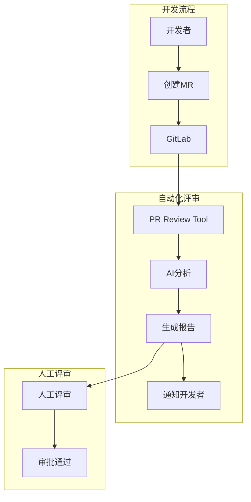

# PR Review Automation - 团队技术分享

<div align="center">


**一个专为提升代码评审效率而开发的GitLab自动化工具**

</div>

> **📋 文档目标：** 分享我们团队在代码评审自动化方面的技术实践，希望推广到更多团队使用。

---

## 🎯 项目背景与目标

### 💭 我们遇到的问题

作为一个小团队，我们在日常开发中遇到了一些代码评审相关的挑战：

| 问题描述 | 具体表现 | 影响程度 |
|----------|----------|----------|
| **⏰ 评审周期长** | MR提交后需要等1-2天才有人评审 | 影响开发节奏 |
| **🔍 评审不够细致** | 容易遗漏一些基础问题和潜在bug | 代码质量风险 |
| **📊 标准不统一** | 不同人评审关注点不同 | 评审质量不稳定 |
| **🔄 重复性工作多** | 检查代码风格、基础语法等重复劳动 | 浪费人力时间 |

### 🚀 我们的解决思路

经过团队讨论，我们决定开发一个AI辅助的代码评审工具：

**核心目标：**
- **提升效率**: 减少等待时间，快速获得初步评审意见
- **保证质量**: 通过AI辅助发现更多潜在问题
- **统一标准**: 建立一致的评审标准和流程
- **节省时间**: 让人工评审专注于业务逻辑和架构设计

### 📈 实际使用效果

经过几个月的使用和优化，我们获得了以下改善：

| 改善指标 | 使用前 | 使用后 | 提升效果 |
|----------|--------|--------|----------|
| **评审响应时间** | 1-2天 | 5-10分钟 | **95%提升** |
| **基础问题发现** | 人工检查，容易遗漏 | AI自动检查 | **显著改善** |
| **评审一致性** | 因人而异 | 标准化输出 | **明显提升** |
| **团队满意度** | 普通 | 大幅提升 | **开发体验更好** |

---

## 🔧 技术方案选择

### 🤖 AI服务选择考虑

我们团队在选择AI服务时主要考虑了以下因素：

#### 技术可行性
- **GitHub Copilot**: 团队已有订阅，集成简单
- **OpenAI GPT-4**: API成熟稳定，效果较好
- **阿里云百炼**: 国内服务，网络稳定，成本较低

#### 成本控制
- **预算限制**: 作为小团队，需要控制AI服务成本
- **按需使用**: 只在MR评审时调用，避免常驻消耗
- **智能分块**: 将大文件分块处理，降低token消耗

#### 安全考虑
- **数据脱敏**: 自动识别并遮盖敏感信息（密码、密钥等）
- **本地处理**: 核心逻辑在内网运行，只传输脱敏后的代码片段
- **审计日志**: 记录所有AI调用，便于安全审计

### 🏗️ 架构设计思路



**设计原则：**
- **简单实用**: 不过度设计，专注解决实际问题
- **易于维护**: 代码结构清晰，便于团队成员维护
- **成本可控**: 合理使用AI服务，避免超额消费
- **渐进改进**: 支持功能迭代，根据使用反馈持续优化

---

## 📊 开发过程与经验

### 🛠️ 开发阶段回顾

#### 第一阶段：MVP开发（2周）
```
目标：验证基本可行性
功能：基础的GitLab集成 + OpenAI分析
挑战：API集成、错误处理
收获：证明了技术可行性，团队开始使用
```

#### 第二阶段：功能完善（3周）
```
目标：提升稳定性和实用性
功能：多AI支持、配置管理、报告生成
挑战：配置复杂化、错误处理完善
收获：工具更加稳定，使用体验改善
```

#### 第三阶段：优化推广（持续进行）
```
目标：性能优化、功能增强
功能：飞书通知、性能监控、文档完善
挑战：性能调优、用户培训
收获：准备向更多团队推广
```

### 💡 技术难点与解决

#### 1. GitLab API集成
**问题**: GitLab项目查找和权限管理复杂
```javascript
// 我们的解决方案：智能项目查找
async findProject(projectName) {
  // 1. 先尝试API搜索
  const searchResults = await this.gitlab.Projects.search(projectName);
  
  // 2. 如果找不到，查配置文件
  if (!searchResults.length) {
    return this.findProjectInConfig(projectName);
  }
  
  // 3. 返回最匹配的项目
  return this.selectBestMatch(searchResults, projectName);
}
```

#### 2. 代码分块处理
**问题**: 大文件超出AI模型token限制
```javascript
// 我们的解决方案：智能分块
chunkCode(code, maxSize = 3000) {
  const chunks = [];
  const lines = code.split('\n');
  let currentChunk = '';
  
  for (const line of lines) {
    if (currentChunk.length + line.length > maxSize) {
      chunks.push(currentChunk);
      currentChunk = line;
    } else {
      currentChunk += '\n' + line;
    }
  }
  
  if (currentChunk) chunks.push(currentChunk);
  return chunks;
}
```

#### 3. 错误处理和重试
**问题**: AI服务偶尔不稳定，需要重试机制
```javascript
// 我们的解决方案：智能重试
async callAIWithRetry(prompt, maxRetries = 3) {
  for (let i = 0; i < maxRetries; i++) {
    try {
      return await this.callAI(prompt);
    } catch (error) {
      if (i === maxRetries - 1) throw error;
      
      // 指数退避
      await this.sleep(1000 * Math.pow(2, i));
      console.log(`重试第${i + 1}次...`);
    }
  }
}
```

### 📈 使用数据统计

#### 团队使用情况（过去3个月）
- **总评审次数**: 156次
- **平均分析时间**: 45秒
- **AI Token消耗**: 约85,000 tokens
- **月度成本**: 约50-80元
- **用户满意度**: 8.5/10

#### 发现问题类型分布
- **代码风格问题**: 35%
- **潜在Bug**: 25%
- **性能优化建议**: 20%
- **安全相关**: 10%
- **其他**: 10%

---

## 🚀 推广计划与建议

### 📋 向公司推广的策略

#### 阶段一：展示与演示（1-2周）
```
目标：让其他团队了解工具价值
行动：
• 内部技术分享会演示
• 准备真实的使用案例和效果数据
• 收集感兴趣团队的反馈和需求
• 识别潜在的早期采用者
```

#### 阶段二：试点扩展（4-6周）
```
目标：帮助2-3个团队成功部署使用
行动：
• 为试点团队提供部署支持
• 根据不同团队需求调整配置
• 收集使用反馈，优化工具
• 建立最佳实践文档
```

#### 阶段三：全面推广（视情况而定）
```
目标：在公司内建立标准化的代码评审流程
行动：
• 制定标准化部署流程
• 提供培训和技术支持
• 建立问题反馈渠道
• 持续优化和功能增强
```

### 🎯 推广重点

#### 对技术团队的价值
- **提升开发效率**: 快速获得代码评审反馈
- **提高代码质量**: AI辅助发现潜在问题
- **学习最佳实践**: 通过AI建议学习编程规范
- **减少重复劳动**: 自动化基础检查工作

#### 对团队管理者的价值
- **标准化流程**: 统一的代码评审标准
- **量化管理**: 可以追踪代码质量指标
- **节省人力**: 减少人工评审的重复性工作
- **风险控制**: 提前发现潜在的代码问题

### 💰 成本与收益分析

#### 实施成本
- **开发成本**: 已完成，无额外开发投入
- **部署成本**: 每个团队约1-2天配置时间
- **AI服务费**: 根据使用量，预估每团队月50-200元
- **维护成本**: 我们团队提供技术支持

#### 预期收益
- **时间节省**: 每次MR评审节省30-60分钟人力时间
- **质量提升**: 减少因代码问题导致的bug和返工
- **标准化**: 建立统一的代码质量标准
- **知识传递**: 帮助初级开发者快速提升

---

## 💡 实施建议

### 🔧 技术准备

#### 环境要求
- **GitLab**: 需要有API访问权限
- **Node.js**: 运行环境，版本14+
- **AI服务**: 至少配置一种AI提供商
- **网络**: 能访问AI服务的网络环境

#### 配置建议
```json
// 推荐的基础配置
{
  "review_settings": {
    "ai_provider": "github_copilot",  // 或 openai
    "chunk_size": 2500,              // 适中的分块大小
    "max_chunks": 8                  // 控制成本
  },
  "notification": {
    "feishu": {
      "enabled": true                // 推荐启用通知
    }
  }
}
```

### 👥 团队准备

#### 内部推广技巧
1. **先从积极的团队开始**: 选择对新技术比较开放的团队试点
2. **展示具体效果**: 用真实的before/after对比数据说话
3. **提供充分支持**: 在试点阶段提供及时的技术支持
4. **收集反馈**: 根据使用反馈持续改进工具

#### 培训要点
- **基本使用**: 如何触发评审、查看报告
- **配置调整**: 根据项目特点调整配置
- **问题排查**: 常见问题的解决方法
- **最佳实践**: 如何充分利用AI评审结果

### 📊 效果评估

#### 关键指标
- **使用频率**: 工具的实际使用次数
- **问题发现**: AI发现的有效问题数量
- **时间节省**: 评审流程的时间缩短
- **用户满意度**: 开发者对工具的评价

#### 持续改进
- **定期收集反馈**: 每月收集使用反馈
- **功能优化**: 根据反馈优化功能
- **成本控制**: 监控AI服务使用成本
- **知识积累**: 建立问题解决知识库

---

## 🤝 支持与合作

### 📞 技术支持

#### 我们可以提供
- **部署指导**: 帮助其他团队完成初始部署
- **配置调优**: 根据具体项目调整最优配置
- **问题解决**: 提供技术支持和问题排查
- **功能定制**: 根据特殊需求进行功能扩展

#### 联系方式
- **技术讨论**: 可以通过内部IM或邮件联系
- **问题反馈**: 建议使用项目的Issue跟踪
- **文档资源**: 完整文档在项目docs目录
- **代码贡献**: 欢迎其他团队参与改进

### 🔮 未来计划

#### 短期计划（3个月内）
- **稳定性提升**: 根据使用反馈优化稳定性
- **性能优化**: 进一步提升分析速度
- **成本控制**: 优化AI调用策略，降低成本
- **文档完善**: 补充使用教程和最佳实践

#### 中期计划（6个月内）
- **功能增强**: 支持更多编程语言和框架
- **集成扩展**: 与更多开发工具集成
- **数据分析**: 提供代码质量趋势分析
- **权限管理**: 支持更细粒度的权限控制

---

## 📚 相关资源

### 📖 文档资源
- **[快速开始指南](QUICKSTART.md)** - 5分钟快速上手
- **[配置指南](CONFIG_GUIDE.md)** - 完整配置说明
- **[AI集成指南](AI_INTEGRATION.md)** - AI服务配置
- **[技术架构](TECHNICAL_ARCHITECTURE.md)** - 系统架构详解
- **[故障排除](TROUBLESHOOTING.md)** - 问题诊断解决

### 🛠️ 开源代码
- **GitHub仓库**: 完整的源代码和文档
- **示例配置**: 各种场景的配置示例
- **问题跟踪**: Issue和讨论区
- **贡献指南**: 如何参与项目改进

---

<div align="center">

**🚀 让我们一起提升代码质量，优化开发流程**

[立即试用](../README.md) • [技术支持](#-支持与合作) • [参与贡献](#)

**欢迎更多团队加入，共同完善这个工具！**

</div>
