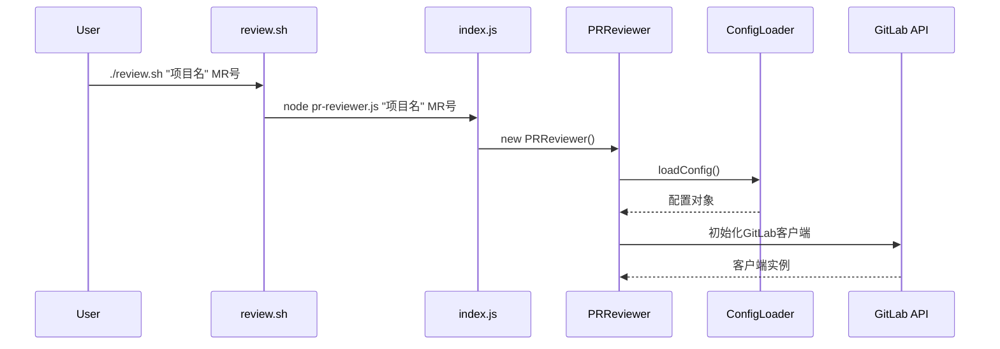
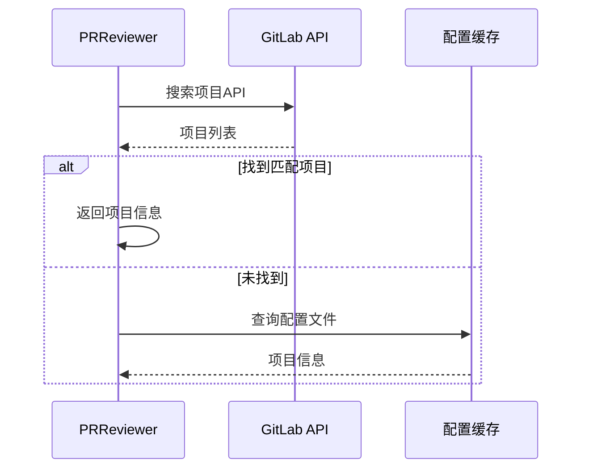
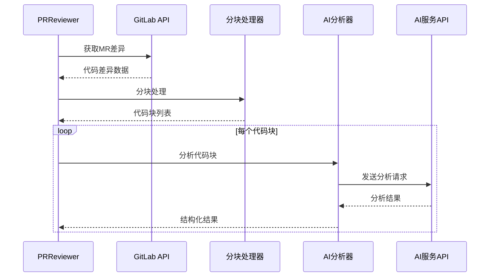
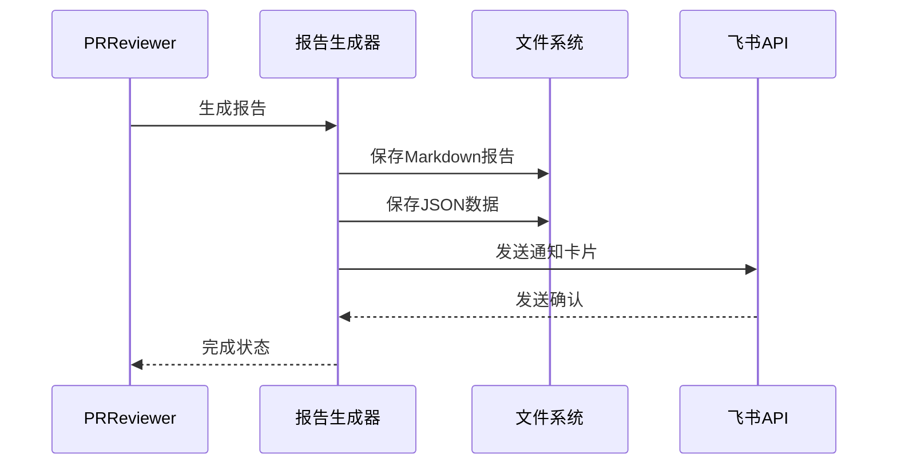

# 技术架构文档

> 深入了解PR Review Automation的技术架构设计、核心实现和调用链分析

## 🏗️ 系统架构总览

```mermaid
graph TB
    subgraph "🌐 外部系统"
        GitLab[🦊 GitLab Server]
        Dev[👨‍💻 开发者]
        Feishu[📱 飞书群聊]
    end
    
    subgraph "🚀 PR Review Automation"
        Entry[📥 入口层]
        Core[🧠 核心逻辑层]
        AI[🤖 AI分析层]
        Output[📤 输出层]
        
        subgraph "📥 入口层组件"
            CLI[review.sh]
            NodeEntry[index.js]
            Reviewer[pr-reviewer.js]
        end
        
        subgraph "🧠 核心逻辑层"
            ConfigLoader[配置加载器]
            ProjectFinder[项目查找器]
            DiffAnalyzer[代码差异分析]
            ChunkProcessor[代码分块处理]
        end
        
        subgraph "🤖 AI分析层"
            Copilot[GitHub Copilot]
            OpenAI[OpenAI GPT-4]
            Bailian[阿里云百炼]
            AutoCopilot[VS Code Copilot]
        end
        
        subgraph "📤 输出层"
            ReportGen[报告生成器]
            NotificationSender[通知发送器]
            FileServer[文件服务器]
        end
    end
    
    subgraph "🤖 AI服务"
        GPT4[GPT-4.1 API]
        BailianAPI[百炼API]
        CopilotAPI[Copilot API]
    end
    
    Dev -->|创建MR| GitLab
    GitLab -->|Webhook/手动触发| CLI
    CLI --> NodeEntry
    NodeEntry --> Reviewer
    Reviewer --> ConfigLoader
    Reviewer --> ProjectFinder
    Reviewer --> DiffAnalyzer
    DiffAnalyzer --> ChunkProcessor
    ChunkProcessor --> AI
    AI --> GPT4
    AI --> BailianAPI
    AI --> CopilotAPI
    GPT4 --> AI
    BailianAPI --> AI
    CopilotAPI --> AI
    AI --> ReportGen
    ReportGen --> NotificationSender
    ReportGen --> FileServer
    NotificationSender --> Feishu
    FileServer -->|Web访问| Dev
```



## 🔧 核心技术栈

| 分层 | 技术栈 | 说明 |
|------|--------|------|
| **运行时** | Node.js 14+ | JavaScript运行环境 |
| **核心框架** | ES6 Modules | 模块化架构 |
| **API集成** | @gitbeaker/rest | GitLab API客户端 |
| **AI服务** | OpenAI, 阿里云百炼, GitHub Copilot | 多AI提供商支持 |
| **通知服务** | 飞书Webhook, SMTP | 多渠道通知 |
| **文件服务** | Express.js | 静态文件服务器 |
| **配置管理** | JSON + 环境变量 | 灵活配置系统 |

## 📁 项目结构设计

### 模块化目录结构
```
pr-review-automation/
├── 🚀 入口层
│   ├── review.sh              # Shell脚本入口
│   ├── index.js               # Node.js入口
│   └── pr-reviewer.js         # 核心评审类
│
├── 📦 源代码模块 (src/)
│   ├── 🤖 analyzers/          # AI分析器模块
│   │   ├── openai-analyzer.js
│   │   ├── aliyun-bailian-analyzer.js
│   │   ├── copilot-extension.js
│   │   └── base-analyzer.js
│   │
│   ├── ⚙️ config/             # 配置管理模块
│   │   └── config-loader.js
│   │
│   └── 🛠️ utils/              # 工具函数模块
│       ├── check-feishu.js
│       ├── validate-config.js
│       └── health-check.js
│
├── 📋 配置文件 (config/)
│   ├── config.json            # 主配置文件
│   └── *.json                 # 专用配置文件
│
├── 📄 文档 (docs/)
│   ├── README.md              # 文档中心
│   ├── QUICKSTART.md          # 快速开始
│   ├── CONFIG_GUIDE.md        # 配置指南
│   └── *.md                   # 其他文档
│
└── 📊 输出目录
    ├── reports/               # 评审报告
    ├── logs/                  # 日志文件
    └── temp/                  # 临时文件
```

### 模块职责划分

#### 🚀 入口层
- **review.sh**: 外部系统调用入口，保持兼容性
- **index.js**: Node.js程序统一入口点
- **pr-reviewer.js**: 核心评审逻辑和主要类定义

#### 📦 源代码模块
- **analyzers/**: AI分析器实现，支持多种AI提供商
- **config/**: 配置管理，统一处理所有配置相关逻辑
- **utils/**: 工具函数，提供通用功能和系统检查

## 🧠 核心类设计

### PRReviewer 主类
```javascript
class PRReviewer {
    constructor() {
        this.config = null;
        this.gitlab = null;
        this.logger = null;
        this.analyzers = new Map();
    }

    // 核心方法
    async initialize()              // 初始化系统
    async findProject(projectName)  // 查找项目
    async getMRDiff(projectId, mrId) // 获取MR差异
    async analyzeCode(diff)         // 分析代码
    async generateReport(analysis)  // 生成报告
    async sendNotification(report)  // 发送通知
}
```

### 配置管理系统
```javascript
class ConfigLoader {
    static async loadConfig() {
        // 1. 加载JSON配置文件
        // 2. 处理环境变量替换
        // 3. 验证配置完整性
        // 4. 返回完整配置对象
    }

    static validateConfig(config) {
        // 配置验证逻辑
    }

    static replaceEnvVariables(config) {
        // 环境变量替换
    }
}
```

### AI分析器架构
```javascript
class BaseAnalyzer {
    constructor(config) {
        this.config = config;
        this.stats = { tokensUsed: 0, requestCount: 0 };
    }

    async analyze(code) {
        // 基础分析流程
    }

    async callAPI(prompt) {
        // API调用通用逻辑
    }
}

class OpenAIAnalyzer extends BaseAnalyzer {
    async callAPI(prompt) {
        // OpenAI特定实现
    }
}

class BailianAnalyzer extends BaseAnalyzer {
    async callAPI(prompt) {
        // 阿里云百炼特定实现
    }
}
```

## 🔄 完整调用链分析

### 1. 初始化阶段


### 2. 项目查找阶段


### 3. 代码分析阶段


### 4. 报告生成阶段


## 🔐 安全架构设计

### 数据安全
```javascript
class SecurityManager {
    // 数据脱敏
    static maskSensitiveData(content) {
        const patterns = [
            /password\s*=\s*['"][^'"]*['"]/gi,
            /token\s*=\s*['"][^'"]*['"]/gi,
            /api_key\s*=\s*['"][^'"]*['"]/gi
        ];
        
        patterns.forEach(pattern => {
            content = content.replace(pattern, 'MASKED');
        });
        
        return content;
    }

    // 网络隔离检查
    static checkNetworkIsolation() {
        // 检查是否在内网环境
    }
}
```

### 配置安全
```javascript
// 环境变量替换机制
const configValue = "${GITLAB_TOKEN}";  // 配置文件中
const actualValue = process.env.GITLAB_TOKEN;  // 运行时替换
```

## ⚡ 性能优化设计

### 1. 代码分块策略
```javascript
class ChunkProcessor {
    static chunkCode(code, maxSize = 3000, overlap = 200) {
        const chunks = [];
        let start = 0;
        
        while (start < code.length) {
            const end = Math.min(start + maxSize, code.length);
            const chunk = code.substring(start, end);
            chunks.push(chunk);
            start = end - overlap;
        }
        
        return chunks;
    }
}
```

### 2. 并行处理机制
```javascript
class AnalysisOrchestrator {
    async analyzeInParallel(chunks, analyzer) {
        const promises = chunks.map(chunk => 
            analyzer.analyze(chunk).catch(error => ({ error }))
        );
        
        const results = await Promise.all(promises);
        return this.mergeResults(results);
    }
}
```

### 3. 错误恢复机制
```javascript
class RetryManager {
    static async withRetry(operation, maxRetries = 3, delay = 1000) {
        for (let attempt = 1; attempt <= maxRetries; attempt++) {
            try {
                return await operation();
            } catch (error) {
                if (attempt === maxRetries || !this.shouldRetry(error)) {
                    throw error;
                }
                await this.delay(delay * attempt);
            }
        }
    }

    static shouldRetry(error) {
        const retryableErrors = ['ENOTFOUND', 'ECONNRESET', 'TIMEOUT'];
        return retryableErrors.some(err => error.message.includes(err));
    }
}
```

## 📊 监控和日志系统

### 日志架构
```javascript
class Logger {
    constructor(component) {
        this.component = component;
        this.level = process.env.LOG_LEVEL || 'info';
    }

    info(message, data = {}) {
        this.log('info', message, data);
    }

    error(message, error = null) {
        this.log('error', message, { error: error?.stack });
    }

    log(level, message, data) {
        const logEntry = {
            timestamp: new Date().toISOString(),
            level,
            component: this.component,
            message,
            ...data
        };
        
        console.log(JSON.stringify(logEntry));
        
        if (this.shouldSaveToFile(level)) {
            this.saveToFile(logEntry);
        }
    }
}
```

### 性能监控
```javascript
class PerformanceMonitor {
    static startTimer(operation) {
        return {
            operation,
            startTime: Date.now(),
            end() {
                const duration = Date.now() - this.startTime;
                console.log(`⏱️ ${operation}: ${duration}ms`);
                return duration;
            }
        };
    }

    static trackTokenUsage(provider, tokens) {
        console.log(`📊 ${provider} Token使用: ${tokens}`);
        // 记录到统计系统
    }
}
```

## 🚀 扩展性设计

### AI分析器插件系统
```javascript
class AnalyzerRegistry {
    static analyzers = new Map();

    static register(name, analyzerClass) {
        this.analyzers.set(name, analyzerClass);
    }

    static create(name, config) {
        const AnalyzerClass = this.analyzers.get(name);
        if (!AnalyzerClass) {
            throw new Error(`未知的分析器: ${name}`);
        }
        return new AnalyzerClass(config);
    }
}

// 使用示例
AnalyzerRegistry.register('openai', OpenAIAnalyzer);
AnalyzerRegistry.register('bailian', BailianAnalyzer);
```

### 配置扩展机制
```javascript
class ConfigExtension {
    static extendConfig(baseConfig, extension) {
        return {
            ...baseConfig,
            ...extension,
            // 深度合并数组和对象
            ai_config: {
                ...baseConfig.ai_config,
                ...extension.ai_config
            }
        };
    }
}
```

## 🔄 部署和运维

### Docker化部署
```dockerfile
FROM node:16-alpine

WORKDIR /app
COPY package*.json ./
RUN npm ci --only=production

COPY . .
EXPOSE 3000

CMD ["node", "index.js"]
```

### 健康检查
```javascript
class HealthChecker {
    static async checkSystem() {
        const checks = {
            config: await this.checkConfig(),
            gitlab: await this.checkGitLab(),
            ai_services: await this.checkAIServices(),
            file_system: await this.checkFileSystem()
        };

        const healthy = Object.values(checks).every(check => check.status === 'ok');
        return { healthy, checks };
    }
}
```

---

**🎯 这个技术架构设计确保了系统的可扩展性、可维护性和高性能，支持企业级的代码评审需求！**
